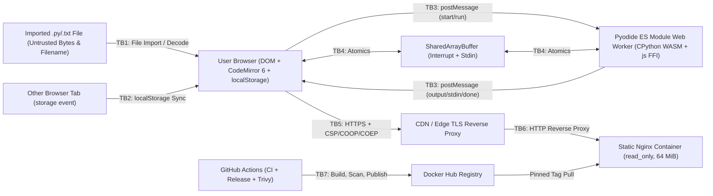

# Security Audit — hexawulf/py-scratchpad — 2026-11-25

## 1. Executive summary

- **Overall risk rating:** **Low-Medium** (no Critical or High vulnerabilities found; strong foundational architecture with zero backend, strict CSP, cross-origin isolation, pinned npm dependencies, and zero known npm CVEs).
- **Summary:** A full multi-layer security audit of `hexawulf/py-scratchpad` at commit `d41aa2fab3c258e19a028b5f7b2ea47dd873333f` examined 12 applicable stack layers across the TypeScript/Vite/CodeMirror frontend, Pyodide Web Worker runtime, Python runner, nginx/Docker container configuration, edge proxy template, and GitHub Actions CI/CD pipelines. Independent verification deduplicated 64 raw swarm findings into **45 verified findings** (0 Critical, 0 High, 14 Medium, 24 Low, 7 Info; 0 rejected false positives). The primary risks center on: (1) unvalidated Worker-to-Page `postMessage` events and an unbounded `promptTracker` that allow untrusted Python code to bypass output caps or disrupt the Stop/UI state machine; (2) Docker build-context leakage via `.dockerignore`, unpinned/ARG-interpolated Docker base images breaking Dependabot, and `release.yml` scanning only `linux/amd64` via `/var/run/docker.sock` before a separate multi-arch rebuild; and (3) public git history exposing origin network topology alongside missing GitHub repository governance rules.

### Findings count by severity

| Severity | Confirmed | Downgraded (into sev) | Total | Fixed on branch | Manual / Deferred |
|---|---:|---:|---:|---:|---:|
| Critical | 0 | 0 | 0 | 0 | 0 |
| High | 0 | 0 | 0 | 0 | 0 |
| Medium | 14 | 0 | 14 | 11 (2 partial manual) | 3 |
| Low | 20 | 4 | 24 | 20 (2 partial manual) | 4 |
| Info | 2 | 5 | 7 | 1 (`CICD-009`) | 6 (below `min_severity_to_fix: low`) |
| **Total** | **36** | **9** | **45** | **32** | **13** |

### Top 3 risks in plain language

1. **Worker protocol spoofing & unbounded prompt memory (`LOGIC-002`, `API-002`):** Python code running in Pyodide can reach `js.postMessage` on the worker's global channel, and ordinary newline-free `print()` calls bypass `OutputLimiter` through `promptTracker`, enabling tab freezes, Stop-timer disruption, or UI state corruption when running untrusted snippets.
2. **Release pipeline & container build-context gaps (`CICD-001`, `CICD-004`, `SECRETS-001`, `DEPS-002`):** `.dockerignore` does not exclude local `.env` or compose backup files; `ARG`-interpolated `FROM` lines silently disable Dependabot Docker updates; and `release.yml` mounts `/var/run/docker.sock` inside the `publish` job while scanning only `linux/amd64` before running an unpinned separate multi-arch rebuild.
3. **Origin IP in public git history & missing GitHub repository protections (`SECRETS-002`, `CICD-002`, `CICD-003`, `DEPS-003`):** Pre-placeholder commits remain in public git history (enabling direct-to-origin requests if the origin firewall is not restricted to CDN IP ranges), and repository settings currently disable Dependabot security updates and lack required CI checks, commit/tag signature enforcement, and a release Environment gate.

### **Manual actions required (operator / out-of-band)**

- **Restrict origin ingress to CDN IPs or rotate origin WAN IP (`SECRETS-002`):** Ensure edge firewall permits TCP 80/443 exclusively from CDN IP ranges (or use Authenticated Origin Pulls / tunnel), rotate the origin WAN IP if feasible, and delete stale remote branch `origin/fix/2026-11-13-medium-bugs` if obsolete.
- **Enable Dependabot alerts & Dependabot security updates (`DEPS-003`):** GitHub Repository Settings -> Code security -> enable Dependabot security updates (currently `disabled`).
- **Harden GitHub rulesets & release Environment (`CICD-002`, `CICD-003`, `CICD-011`):** Add `required_signatures` and required status check (`Test`) to `protect-main`; create a `v*` tag protection ruleset; create a `release` GitHub Environment for Docker Hub secrets; enable secret scanning validity checks, non-provider patterns, and `delete_branch_on_merge`.
- **Deploy updated edge reverse-proxy vhost & verify HSTS/TLS (`INFRA-001`, `INFRA-002`, `AUTHZ-001`, `AUTHZ-002`, `CRYPTO-002`):** Check CDN dashboard HSTS settings (to avoid duplicate headers), verify global edge nginx TLS/cipher/`server_tokens` settings, and install the hardened `docs/nginx/py-scratchpad.com` template via the operator approval gate (`docs/DEPLOY.md` §6).
- **Optional Certbot account unlinkability (`SECRETS-003`):** No private key was leaked, but the ACME account ID existed in prior git history; re-register if unlinkability is desired.

---

## 2. Scope & method

- **Commit SHA audited:** `d41aa2fab3c258e19a028b5f7b2ea47dd873333f` (`main`)
- **Work branch:** `security/audit-2026-11-25` (branched from `origin/main`)
- **Repository visibility:** Public
- **In scope:** All tracked source files (`src/`, `build/`, `scripts/`, `tests/`, `docker/`, `docs/`, `.github/`, `Dockerfile`, `docker-compose*.yml`, `index.html`, `package.json`, `package-lock.json`, `vite.config.ts`, `public/`).
- **Out of scope:** `vendor/pyodide/LICENSE`, `node_modules/`, `dist/`, live production host configs outside the repository.
- **Run mode:** Parallel swarm (8 read-only layer auditors in Phase 1 + 1 independent fresh verifier in Phase 2).
- **Layers covered (12):** `secrets`, `deps`, `authz`, `injection`, `web`, `api`, `crypto`, `containers`, `infra`, `cicd`, `logging`, `logic`.
- **Layers skipped (2):**
  - `authn` — Proven N/A: static browser-only site with no backend, no user accounts, no login, no cookies/sessions, no JWT/OAuth.
  - `llm` — Proven N/A: no LLM, AI model, or agent features exist in the repository.
- **Tools run:**
  - `gitleaks` `v8.30.1` (containerized) — 49 commits + working tree scanned: 0 leaks.
  - `actionlint` `1.7.7` (containerized) — 0 errors.
  - `npm audit` (npm 10/11 via Node 22) — 0 vulnerabilities across 188 locked packages.
  - `OSV API` (`api.osv.dev/v1/querybatch`) — 0 advisories across all 188 locked npm packages.
  - `eslint` (`npm run lint`) — 0 errors.
  - `vitest` `5.1.1` (`npm test`) — 14 test files, 280/280 tests passed.
  - `docker buildx imagetools inspect` — verified upstream Node/Nginx multi-arch digests.
- **Tools unavailable locally (manual review performed):** `trufflehog`, `semgrep`, `bandit`, `gosec`, `brakeman`, `osv-scanner`, `pip-audit`, `cargo audit`, `govulncheck`, `bundler-audit`, `trivy` (runs in `release.yml`), `hadolint`, `checkov`, `tfsec`, `zizmor`, `eslint-plugin-security`.
- **Limitations:** Static code and configuration audit cannot inspect live CDN dashboard settings, unversioned global edge reverse-proxy configs, or runtime OS packages inside images built on future dates.

---

## 3. Architecture & trust boundaries

`py-scratchpad` is a zero-backend static web application serving a CodeMirror 6 editor and a self-hosted Pyodide WebAssembly CPython interpreter running inside a dedicated ES module Web Worker. All user code persists exclusively in browser `localStorage` (`py-scratchpad:v1`).

---

## 4. Findings

Ordered by verified severity, then by layer. All code fixes are applied and verified on branch `security/audit-2026-11-25`, awaiting operator GPG-signed commits per `CLAUDE.md`.

### [MEDIUM] LOGIC-002 — Unvalidated Worker-to-Page postMessage events and spoofable protocol channel via Pyodide js FFI
*(Merged Phase 1 IDs: `LOGIC-002`, `WEB-001`, `API-001`)*
- **Location:** `src/pyodide.worker.ts:54-58,106-131`, `src/runner.ts:152-154,193-234`, `src/main.ts:809-831,918-941,1000-1011`
- **CWE / OWASP / Confidence:** CWE-345 / A04:2021 / Confirmed
- **Description:** User Python code running inside Pyodide can access `DedicatedWorkerGlobalScope` via `import js` and call `js.postMessage(...)` on the same channel used by `pyodide.worker.ts`. `src/runner.ts:handle()` performs no runtime schema validation, enforces no phase-transition checks, and relies exclusively on the worker-side `OutputLimiter`.
- **Evidence:** `src/pyodide.worker.ts:54-58` posts on `self.postMessage(event)`. `src/runner.ts:193-234` switches on `event.kind` without validating field types, accepts `ready`/`failed` in any phase, clears `stopTimer` on `done`, accepts `stdin` without checking `isAwaitingStdin(stdin)`, and forwards unvalidated `event.stream` and unbounded `event.text` to `src/main.ts:815` (`span.className = 'out-' + stream`).
- **Exploit scenario:** A user pastes or opens an untrusted Python snippet and clicks Run. The script invokes `js.postMessage` with forged `WorkerEvent` payloads matching the sequential `runId`, bypassing the 1 MB / 10,000-line output cap to OOM-freeze the tab, cancelling Stop's 500 ms termination timer via forged `done`/`ready`, injecting CSS classes via `stream`, or leaving the UI stuck in `'input'` phase.
- **Fix:** Add strict runtime parser `parseWorkerEvent()` in `src/protocol.ts`; enforce strict phase guards, `isAwaitingStdin()` check on `stdin`, main-thread `OutputLimiter`, and `PROMPT_MAX_CHARS` cap in `src/runner.ts`; isolate worker-to-page transport over a closure-private `MessageChannel` port for real workers.
- **Status:** Fixed on branch `security/audit-2026-11-25` (pending operator signed commit)

### [MEDIUM] API-002 — Unbounded promptTracker growth bypasses OutputLimiter and enables worker OOM and main-thread UI freeze
*(Merged Phase 1 IDs: `API-002`, `LOGIC-001`, `INJECTION-007`)*
- **Location:** `src/output.ts:210-230`, `src/pyodide.worker.ts:106-131,169-174`, `src/main.ts:928-935`
- **CWE / OWASP / Confidence:** CWE-770 / A04:2021 / Confirmed
- **Description:** `emit()` calls `promptTracker.write(text)` before checking `limiter.truncated`, and `createPromptTracker()` concatenates newline-free stdout indefinitely with no character cap.
- **Evidence:** `src/pyodide.worker.ts:109` runs `if (stream === 'out') promptTracker.write(text)` before `limiter.accept(text)`. `src/output.ts:217` computes `pending = lastBreak === -1 ? pending + text : text.slice(lastBreak + 1)`.
- **Exploit scenario:** Ordinary beginner Python code (an accidental infinite loop calling `print(..., end='')`) bypasses the 1 MB output ceiling, growing `pending` until worker OOM or sending a multi-MB string into `#stdin-prompt` when `input()` is called.
- **Fix:** Cap `createPromptTracker()` at `PROMPT_MAX_CHARS = 512` (keeping the trailing 512 chars after the last newline), and enforce the same cap on the main thread.
- **Status:** Fixed on branch `security/audit-2026-11-25` (pending operator signed commit)

### [MEDIUM] LOGIC-003 — Multi-tab and schema-lock state machine desynchronization causes unbacked data loss and silent autosave deadlock
- **Location:** `src/main.ts:251-267,434-453,486-518,612-625`, `src/tabsync.ts:89-118`
- **CWE / OWASP / Confidence:** CWE-362 / A04:2021 / Confirmed
- **Description:** Four state-machine bugs break the "never lose user code" invariant: (1) `saveHereAnyway()` backs up stale `lastWritten` instead of live `storage.getItem(STORAGE_KEY)`; (2) the `storage` listener passes `paused: conflictPending` instead of `paused: savingPaused()`, letting `conflictPending` become true under `lockedNotice` and deadlocking autosave after unlock; (3) `hideNotice()` restores `lockedNotice` but not `CONFLICT_NOTICE`, permanently hiding recovery buttons after any transient toast; (4) `applyOpenedFile()` shows an info toast unconditionally, masking `QuotaExceededError`.
- **Evidence:** `src/main.ts:254-257`, `439`, `496`, `622-623`.
- **Exploit scenario:** In two-tab usage, schema downgrade, or storage-full conditions, newer-schema data can be overwritten without a current backup or autosave can remain silently deadlocked with no UI action to recover.
- **Fix:** Back up live `storage.getItem(STORAGE_KEY)` in `saveHereAnyway()` and clear `conflictPending`; pass `paused: savingPaused()` to `decideOnExternalWrite()`; restore `CONFLICT_NOTICE` in `hideNotice()` when `conflictPending` is true; guard the `Opened ...` notice when `saveFailed || lockedNotice !== null`.
- **Status:** Fixed on branch `security/audit-2026-11-25` (pending operator signed commit)

### [MEDIUM] SECRETS-001 — `.dockerignore` omits `.env`, `.env.*`, docker-compose files, and rollback backups, leaking them into Docker build contexts
*(Merged Phase 1 IDs: `SECRETS-001`, `CONTAINERS-003`)*
- **Location:** `.dockerignore:1-28`, `Dockerfile:27-30`, `scripts/e2e-image.sh:54-56`
- **CWE / OWASP / Confidence:** CWE-538 / A05:2021 / Confirmed
- **Description:** `.dockerignore` does not exclude `.env`, `.env.*`, `docker-compose*.yml*`, or `*.bak*`. When `Dockerfile` runs `COPY . .` during local builds (`npm run test:e2e:image`), local `.env` and compose backup files enter the Docker build context, Stage 1 layers, and BuildKit cache (and Vite auto-loads `.env` files during `npm run build`).
- **Evidence:** `.dockerignore:1-28` omits `.env` / `.env.*` / `docker-compose*.yml*` / `*.bak*`; `Dockerfile:29` runs `COPY . .`.
- **Exploit scenario:** Any local `docker build` archives local `.env` and compose backups into the build context and Stage 1 cache, and any `VITE_*` key in `.env` would be bundled into `dist/`.
- **Fix:** Exclude `.env`, `.env.*`, `docker-compose*.yml*`, `*.bak*`, `.DS_Store`, `*.sw?`, `public/pyodide/`, `blob-report`, `playwright/.cache`, and `playwright.screenshots.config.ts` in `.dockerignore`, and replace `COPY . .` in `Dockerfile` with explicit copies of required build inputs.
- **Status:** Fixed on branch `security/audit-2026-11-25` (pending operator signed commit)

### [MEDIUM] SECRETS-002 — Cloudflare-proxied origin WAN IP and internal network topology remain exposed in public git history
- **Location:** `docs/DEPLOY.md`, `docs/PLAN.md`, `docker-compose.yml`, `docs/nginx/py-scratchpad.com` (commit `ce3764d` / tag `v0.3.11` and earlier)
- **CWE / OWASP / Confidence:** CWE-200 / A01:2021 / Confirmed
- **Description:** While `HEAD` replaced hostnames and IP addresses with placeholders, historical commits (`v0.3.11` and earlier) and stale remote branch `origin/fix/2026-11-13-medium-bugs` still contain the origin WAN IP and internal topology in public git history.
- **Evidence:** Read-only history check on tag `v0.3.11` confirmed multiple internal and public IP occurrences prior to placeholder commits `03119ae` and `d41aa2f`.
- **Exploit scenario:** An external actor reads historical git commits to obtain the origin IP behind the CDN and sends direct-to-origin HTTP/HTTPS traffic bypassing CDN WAF/DDoS controls.
- **Fix:** Cannot be resolved by code edits (history rewrite is forbidden and does not purge existing public clones). Enforce CDN-only IP allowlisting on edge TCP 80/443 (or Authenticated Origin Pulls / tunnel), rotate origin WAN IP if feasible, and delete stale remote branch `origin/fix/2026-11-13-medium-bugs`.
- **Status:** Manual action

### [MEDIUM] DEPS-002 — `ARG`-interpolated `FROM` silently breaks Dependabot Docker updates and leaves image tags mutable without sha256 digests
*(Merged Phase 1 IDs: `DEPS-002`, `CONTAINERS-005`)*
- **Location:** `Dockerfile:10-17,33`, `.github/dependabot.yml:31-37`, `docker-compose.yml:19-20`
- **CWE / OWASP / Confidence:** CWE-1104 / A06:2021 / Confirmed
- **Description:** `Dockerfile` interpolates `ARG` variables inside `FROM`, which Dependabot's `docker` ecosystem silently skips; base images also lack `@sha256:` digest pins.
- **Evidence:** `FROM --platform=$BUILDPLATFORM node:${NODE_VERSION}-alpine${ALPINE_VERSION} AS build` and `FROM nginx:${NGINX_VERSION}-alpine${ALPINE_VERSION}` in `Dockerfile:17,33`.
- **Exploit scenario:** Upstream security patch releases are never picked up by Dependabot, and mutable tags permit silent upstream tag replacement between builds.
- **Fix:** Replace `ARG`-interpolated `FROM` lines with literal, `@sha256:` digest-pinned base images (`node:22.23.5-alpine3.24@sha256:...` and `nginx:1.30.8-alpine3.24-slim@sha256:...`).
- **Status:** Fixed on branch `security/audit-2026-11-25` (pending operator signed commit)

### [MEDIUM] DEPS-003 — Dependabot security updates disabled in repo settings and npm vulnerabilities never scanned in CI or release
*(Merged Phase 1 IDs: `DEPS-003`, `CICD-005`)*
- **Location:** `.github/dependabot.yml:1-18`, `.github/workflows/ci.yml:42-43`, `.github/workflows/release.yml:143-161`
- **CWE / OWASP / Confidence:** CWE-1104 / A06:2021 / Confirmed
- **Description:** GitHub repo settings report `dependabot_security_updates: disabled` (contradicting `.github/dependabot.yml:1`), `ci.yml` runs `npm ci --no-audit --no-fund` with no `npm audit` step, and `release.yml`'s Trivy scan covers only Stage 2 nginx (never `package-lock.json`).
- **Evidence:** GitHub API `security_and_analysis.dependabot_security_updates.status == "disabled"`; `ci.yml:43` omits any npm vulnerability check.
- **Exploit scenario:** A newly disclosed High/Critical npm CVE in any of the 188 locked packages triggers no out-of-band Dependabot security PR and passes both CI and release checks unnoticed.
- **Fix:** Add an `npm audit --audit-level=high` step in `.github/workflows/ci.yml` and clarify `.github/dependabot.yml:1`. Manual action: enable Dependabot alerts & security updates in GitHub Repository Settings.
- **Status:** Fixed on branch `security/audit-2026-11-25` (pending operator signed commit; manual GitHub setting required)

### [MEDIUM] DEPS-004 — `npm ci` runs package lifecycle scripts without `--ignore-scripts` in Dockerfile and CI
*(Merged Phase 1 IDs: `DEPS-004`, `CONTAINERS-007`, `CICD-006`)*
- **Location:** `Dockerfile:27-28`, `.github/workflows/ci.yml:42-43`, `package-lock.json:1568-1575`
- **CWE / OWASP / Confidence:** CWE-829 / A08:2021 / Confirmed
- **Description:** Neither `Dockerfile` nor `ci.yml` passes `--ignore-scripts`, and no `.npmrc` sets `ignore-scripts=true`. Inspection of `package-lock.json` confirms zero Linux/CI/Docker dependencies require install scripts (only optional macOS `fsevents`).
- **Evidence:** `Dockerfile:28` (`RUN npm ci`) and `ci.yml:43` (`npm ci --no-audit --no-fund`).
- **Exploit scenario:** A compromised npm package update introducing a malicious `preinstall`/`postinstall` hook executes automatically during CI or Docker builds prior to tests/lint.
- **Fix:** Add `.npmrc` with `ignore-scripts=true` and pass `--ignore-scripts` in `Dockerfile` and `.github/workflows/ci.yml`.
- **Status:** Fixed on branch `security/audit-2026-11-25` (pending operator signed commit)

### [MEDIUM] CONTAINERS-002 — Container lacks `cap_drop: [ALL]` and `no-new-privileges` runtime hardening
- **Location:** `docker-compose.yml:18-44`, `scripts/e2e-image.sh:60-64`, `docs/DOCKERHUB.md:40-68`
- **CWE / OWASP / Confidence:** CWE-250 / A05:2021 / Confirmed
- **Description:** Production compose, E2E image test, and Docker Hub docs omit `cap_drop: [ALL]` and `security_opt: [no-new-privileges:true]`, leaving Docker's full default capability set enabled.
- **Evidence:** `docker-compose.yml:18-44` defines `read_only: true` and `mem_limit: 64m` without `cap_drop`, `cap_add`, or `security_opt`.
- **Exploit scenario:** Post-exploitation code execution inside the container inherits unnecessary Linux capabilities (`CAP_NET_RAW`, `CAP_DAC_OVERRIDE`, etc.) and lacks `no-new-privileges`.
- **Fix:** Add `cap_drop: [ALL]`, minimal `cap_add: [CHOWN, NET_BIND_SERVICE, SETGID, SETUID]`, and `security_opt: [no-new-privileges:true]` to `docker-compose.yml`, `scripts/e2e-image.sh`, and `docs/DOCKERHUB.md`.
- **Status:** Fixed on branch `security/audit-2026-11-25` (pending operator signed commit)

### [MEDIUM] INFRA-002 — Edge reverse proxy sets `proxy_buffering off`, `proxy_read_timeout 3600s`, and `client_max_body_size 2m` in front of a 64 MiB static container
- **Location:** `docs/nginx/py-scratchpad.com:88-106`, `docker/nginx.conf:22-32`, `docker-compose.yml:25`
- **CWE / OWASP / Confidence:** CWE-400 / A05:2021 / Confirmed
- **Description:** Disabling `proxy_buffering` with a 3600-second read timeout and 2 MB body limit in front of a 64 MiB static nginx container lets slow-read clients pin upstream connections and gzip buffers inside the container.
- **Evidence:** `docs/nginx/py-scratchpad.com:88,103-105` sets `client_max_body_size 2m`, `proxy_buffering off`, `proxy_read_timeout 3600s`; `docker/nginx.conf` leaves `client_max_body_size` at default `1m`.
- **Exploit scenario:** ~25 concurrent slow-read connections requesting gzipped `pyodide.asm.wasm` (especially via direct-origin access) exhaust the 64 MiB container memory limit and trigger OOM kills.
- **Fix:** Set `client_max_body_size 1k;` in `docker/nginx.conf`, and update `docs/nginx/py-scratchpad.com` to `client_max_body_size 1k;`, `proxy_buffering on;`, and `proxy_connect_timeout 5s; proxy_send_timeout 30s; proxy_read_timeout 30s;`. Manual action: install updated vhost on edge host under operator approval gate.
- **Status:** Fixed in repo on branch `security/audit-2026-11-25` (pending operator signed commit; manual edge deploy required)

### [MEDIUM] CICD-001 — Trivy scans only `linux/amd64` before a separate multi-arch rebuild without `pull: true` (unscanned `arm64` + stale cache + TOCTOU)
*(Merged Phase 1 IDs: `CICD-001`, `CONTAINERS-009`)*
- **Location:** `.github/workflows/release.yml:126-140,143-156,207-221`, `Dockerfile:4-5,33-37`, `SECURITY.md:26`
- **CWE / OWASP / Confidence:** CWE-367 / A08:2021 / Confirmed
- **Description:** `release.yml` builds and scans only `linux/amd64`, then runs a separate multi-arch `Build and push` without `pull: true` while consuming `cache-from: type=gha`. `linux/arm64` is never scanned by Trivy, and cached `apk upgrade` layers can drift between scan and publish.
- **Evidence:** `release.yml:130` (`platforms: linux/amd64`, `pull: true`) vs `release.yml:211` (`platforms: linux/amd64,linux/arm64`, no `pull: true`, `cache-from: type=gha`).
- **Exploit scenario:** An `arm64`-specific CVE or stale cached `apk upgrade` layer bypasses the Trivy CRITICAL release gate and ships to Docker Hub.
- **Fix:** Export OCI tarballs for both `linux/amd64` and `linux/arm64` with `pull: true` in a dedicated `scan` job, run Trivy against both tarballs via `--input`, and enforce `pull: true` on `publish` (with digest-pinned base images from `DEPS-002`). Clarify in `Dockerfile` comments that byte-reproducibility applies to `dist/`.
- **Status:** Fixed on branch `security/audit-2026-11-25` (pending operator signed commit)
- **Review correction:** the first version of this fix would have failed every release: buildx `type=oci` tarballs cannot be read by `trivy --input` (it needs a docker-archive tar or an OCI layout directory), and Trivy running as root with `--cap-drop=ALL` cannot write to the runner-owned `/out`. Both were reproduced locally; the scan now exports `type=docker` archives and runs Trivy as the runner user with `--cache-dir /out/cache`.

### [MEDIUM] CICD-002 — Unprotected release tags (`v*.*.*`), missing `required_signatures` rule, no `main`-ancestry check, and no Environment gate on `publish` job
- **Location:** `.github/workflows/release.yml:13-25,35-73,81-89,196-201`, `CLAUDE.md:28-30`
- **CWE / OWASP / Confidence:** CWE-345 / A08:2021 / Confirmed
- **Description:** GitHub has no tag protection ruleset for `v*`, `protect-main` does not enforce `required_signatures`, `release.yml` does not require tagged commits to be on `main`, and `publish` accesses Docker Hub secrets without a GitHub Environment gate.
- **Evidence:** GitHub API rulesets show only branch ruleset `protect-main` with no `required_signatures` rule and no tag rulesets; `release.yml` has no `environment:` key on `publish`.
- **Exploit scenario:** A compromised repo write credential (without the maintainer's GPG key) can push an unsigned tag on an unreviewed commit and publish an untrusted `:latest` image to Docker Hub.
- **Fix:** Configure tag ruleset (`v*`), `required_signatures`, and a `release` GitHub Environment holding Docker Hub secrets in Repository Settings, then wire `environment: release` and `git merge-base --is-ancestor` in `release.yml`.
- **Status:** Deferred — needs decision (manual GitHub Settings prerequisite)

### [MEDIUM] CICD-003 — `protect-main` ruleset requires zero approvals, zero CI status checks (`Test`), and lacks `CODEOWNERS`
- **Location:** `.github/workflows/ci.yml:25-26`, GitHub `protect-main` ruleset
- **CWE / OWASP / Confidence:** CWE-284 / A08:2021 / Confirmed
- **Description:** `protect-main` sets `required_approving_review_count: 0`, has no `required_status_checks` entry for `Test`, and no `CODEOWNERS` file exists.
- **Evidence:** Live GitHub ruleset `protect-main` parameters show `required_approving_review_count: 0`, `dismiss_stale_reviews_on_push: false`, and no `required_status_checks` rule.
- **Exploit scenario:** A PR modifying security headers or release workflows can merge into `main` even when CI `Test` fails and without review.
- **Fix:** Add `required_status_checks` (`Test`) and review policy to `protect-main` in GitHub Repository Settings.
- **Status:** Manual action

### [MEDIUM] CICD-004 — Trivy mounts `/var/run/docker.sock` (ineffective `:ro`) and `$PWD` read-write in the same job that publishes to Docker Hub
- **Location:** `.github/workflows/release.yml:81-89,143-156,196-221`
- **CWE / OWASP / Confidence:** CWE-250 / A08:2021 / Confirmed
- **Description:** Mounting `/var/run/docker.sock:ro` still permits full read-write daemon socket `connect()` calls, and mounting `$PWD:/src` read-write before `Build and push` places the scanner inside the same job holding `DOCKERHUB_TOKEN` and `security-events: write`.
- **Evidence:** `release.yml:151-155` mounts `/var/run/docker.sock:/var/run/docker.sock:ro` and `"$PWD:/src"` inside the `publish` job.
- **Exploit scenario:** Code execution in the Trivy container can tamper with `$PWD` before the production image build or abuse the Docker daemon socket inside the publishing job.
- **Fix:** Split `scan` from `publish` so `scan` has no Docker Hub secrets, scan exported OCI tarballs via `--input` without mounting `/var/run/docker.sock`, mount `$PWD:/src:ro`, and pass `--cap-drop=ALL --security-opt=no-new-privileges`.
- **Status:** Fixed on branch `security/audit-2026-11-25` (pending operator signed commit)
- **Review correction:** the first version of this fix would have failed every release: buildx `type=oci` tarballs cannot be read by `trivy --input` (it needs a docker-archive tar or an OCI layout directory), and Trivy running as root with `--cap-drop=ALL` cannot write to the runner-owned `/out`. Both were reproduced locally; the scan now exports `type=docker` archives and runs Trivy as the runner user with `--cache-dir /out/cache`.

### [LOW] DEPS-001 — Outdated Docker base images miss Node.js (`22.23.5`) and Nginx (`1.30.8`) security patch releases
*(Downgraded from Medium: Node is Stage 1 build-only; Nginx TLS 1.3 `ssl_early_data` is unreachable on port-80 plaintext container.)*
- **Location:** `Dockerfile:10-17,33`
- **CWE / OWASP / Confidence:** CWE-1104 / A06:2021 / Confirmed
- **Description:** `Dockerfile` pins `node:22.23.3-alpine3.24` and `nginx:1.30.7-alpine3.24`, lagging security patch releases `22.23.5` and `1.30.8`.
- **Evidence:** `Dockerfile:10-12` pins `NODE_VERSION=22.23.3` and `NGINX_VERSION=1.30.7`.
- **Exploit scenario:** Build-time npm TLS/Brotli paths use older Node 22.23.3; downstream users enabling TLS 1.3 `ssl_early_data` inherit nginx 1.30.7's CPU DoS bug.
- **Fix:** Upgrade to digest-pinned `node:22.23.5-alpine3.24` and `nginx:1.30.8-alpine3.24-slim` (combined with `DEPS-002` and `CONTAINERS-006`).
- **Status:** Fixed on branch `security/audit-2026-11-25` (pending operator signed commit)

### [LOW] INJECTION-001 — Unvalidated `request.indexUrl` in dynamic `import()`, re-entrant `start()`, and incomplete worker request dispatch
*(Merged Phase 1 IDs: `INJECTION-001`, `API-003`; downgraded from Medium: `start` comes from trusted main thread and CSP restricts cross-origin modules.)*
- **Location:** `src/pyodide.worker.ts:194-213,240-298`
- **CWE / OWASP / Confidence:** CWE-20 / A03:2021 / Confirmed
- **Description:** `isWorkerRequest` checks only `'kind' in value`, unknown `kind` values fall through to `execute()`, `start()` has no single-init guard, and `request.indexUrl` is interpolated into dynamic `import()` without format validation.
- **Evidence:** `src/pyodide.worker.ts:197,279-298`.
- **Exploit scenario:** Malformed messages or synthetic worker `MessageEvent` dispatch can fall through to `execute()` or re-enter `start()` with an arbitrary path.
- **Fix:** Add `started` guard, validate `request.indexUrl` matches `/^\/pyodide\/[0-9A-Za-z._-]+\/$/` with no `..`, and implement strict `parseWorkerRequest()` dispatch ignoring unknown kinds.
- **Status:** Fixed on branch `security/audit-2026-11-25` (pending operator signed commit)

### [LOW] INFRA-001 — Missing `Strict-Transport-Security` (HSTS) header on public HTTPS edge proxy template
*(Merged Phase 1 IDs: `INFRA-001`, `WEB-003`, `CRYPTO-001`; downgraded from Medium: static app with zero accounts/cookies behind CDN `always_use_https`.)*
- **Location:** `docs/nginx/py-scratchpad.com:31-35,54-107`, `docker/security-headers.conf:25-29`
- **CWE / OWASP / Confidence:** CWE-319 / A02:2021 / Confirmed
- **Description:** Neither the HTTPS edge vhost template nor container emits HSTS (container rightly omits it for plain-HTTP self-hosters; CDN HSTS state is outside this repo).
- **Evidence:** `docs/nginx/py-scratchpad.com:54-107` has no `Strict-Transport-Security` header.
- **Exploit scenario:** An active network MITM intercepts an initial plaintext `http://` navigation before redirect if CDN HSTS is not enabled.
- **Fix:** Check CDN dashboard HSTS setting first; enable HSTS either at the CDN edge or in the edge vhost's 443 server blocks (without duplicating headers) under the operator approval gate.
- **Status:** Manual action

### [LOW] CONTAINERS-001 — Nginx container runs master process as root (UID 0) on privileged port 80
*(Downgraded from Medium: workers drop to non-root `nginx` on `read_only: true` static container; moving port 80 -> 8080 is breaking for Docker Hub consumers.)*
- **Location:** `Dockerfile:33-52`, `docker/nginx.conf:22-25`, `docs/DOCKERHUB.md:149-155`
- **CWE / OWASP / Confidence:** CWE-250 / A05:2021 / Confirmed
- **Description:** Nginx master runs as UID 0 to bind port 80 before spawning UID 101 workers.
- **Evidence:** `Dockerfile` runtime stage sets no `USER`; `docker/nginx.conf:23-24` listens on port 80.
- **Exploit scenario:** Compromise of PID 1/entrypoint prior to worker drop runs as container root, and Kubernetes `runAsNonRoot: true` rejects the image.
- **Fix:** Defer to a planned minor/breaking release (`0.4.0`) migrating to `USER 101:101`, `pid /tmp/nginx.pid`, and unprivileged port `8080`.
- **Status:** Deferred — needs decision (breaking port 80 -> 8080 change)

### [LOW] SECRETS-003 — Production Let's Encrypt ACME account ID committed in `docs/DEPLOY.md`
- **Location:** `docs/DEPLOY.md:418-428`
- **CWE / OWASP / Confidence:** CWE-200 / A05:2021 / Confirmed
- **Description:** Line 420 contains a real Certbot ACME account ID (`5258****295f`) missed during placeholder scrubbing.
- **Evidence:** `docs/DEPLOY.md:420` (`account = 5258****295f`).
- **Exploit scenario:** Public repo readers obtain a production Certbot account identifier associated with the edge host.
- **Fix:** Replace with `account = <acme-account-id>`.
- **Status:** Fixed on branch `security/audit-2026-11-25` (pending operator signed commit)

### [LOW] SECRETS-004 — Edge credential file path, token scope, and unrelated co-hosted infrastructure details exposed in public docs and nginx template
- **Location:** `docs/DEPLOY.md:384-396,407-416,452-464,494-497`, `docs/PLAN.md:239-267,295-324,359-371`, `docs/nginx/py-scratchpad.com:13-26`
- **CWE / OWASP / Confidence:** CWE-200 / A05:2021 / Confirmed
- **Description:** Public documentation names a root DNS credential file path, unrelated sibling production domains sharing the edge proxy, internal monitor IDs/channels, and private runbook paths.
- **Evidence:** Explicit credential path and sibling vhost names in `docs/DEPLOY.md`, `docs/PLAN.md`, and `docs/nginx/py-scratchpad.com`.
- **Exploit scenario:** Attackers map unrelated co-hosted domains on the same edge host and know exact credential file paths for post-compromise lookup.
- **Fix:** Replace unrelated sibling domains, credential paths, monitor IDs, and private runbook references with generic placeholders.
- **Status:** Fixed on branch `security/audit-2026-11-25` (pending operator signed commit)

### [LOW] SECRETS-005 — Rollback compose backups (`docker-compose.yml.bak-*`) ignored only in local `.git/info/exclude`, not in tracked `.gitignore`
- **Location:** `.gitignore:1-37`, `docs/DEPLOY.md:335-337`
- **CWE / OWASP / Confidence:** CWE-538 / A05:2021 / Confirmed
- **Description:** `docker-compose.yml.bak-*` is ignored only via untracked `.git/info/exclude`, not tracked `.gitignore`.
- **Evidence:** `git check-ignore -v` matches `.git/info/exclude:7`.
- **Exploit scenario:** Fresh clones lack the exclude rule, risking accidental commit of local backup files.
- **Fix:** Add `docker-compose.yml.bak-*` and `*.bak-*` to `.gitignore` and recommend storing backups outside the repo in `docs/DEPLOY.md`.
- **Status:** Fixed on branch `security/audit-2026-11-25` (pending operator signed commit)

### [LOW] INJECTION-002 — Unbounded file import size and regex match-array allocations in `openFile()` / `detectLineEnding()` enable tab OOM
*(Merged Phase 1 IDs: `INJECTION-002`, `LOGIC-005`)*
- **Location:** `src/main.ts:612-653`, `src/files.ts:78-96,108-124`
- **CWE / OWASP / Confidence:** CWE-400 / A04:2021 / Confirmed
- **Description:** `openFile()` reads arbitrary-size files into memory with no cap, concurrent opens can race across `await`, and `detectLineEnding()` allocates global regex match arrays for every newline.
- **Evidence:** `src/main.ts:632` (`await file.arrayBuffer()`) and `src/files.ts:78-95` (`text.match(...)`).
- **Exploit scenario:** Importing or dropping an oversized file OOM-crashes the browser tab and loses unsaved work.
- **Fix:** Enforce `MAX_OPEN_FILE_BYTES = 2 * 1024 * 1024` before reading, convert `detectLineEnding()` to a single O(1)-memory scan, and guard concurrent opens with a monotonic `openRequestId`.
- **Status:** Fixed on branch `security/audit-2026-11-25` (pending operator signed commit)

### [LOW] INJECTION-003 — Incomplete filename sanitization allows Unicode Bidi spoofing, Windows reserved names, and OS-illegal characters
- **Location:** `src/files.ts:60-72`, `src/main.ts:722-734`
- **CWE / OWASP / Confidence:** CWE-451 / A03:2021 / Confirmed
- **Description:** `sanitizeFilename()` only strips C0 controls, DEL, and `/\`, permitting Unicode Bidi overrides (U+202E), C1 controls, Windows-illegal characters (`<>:"|?*`, including `<exec>`), trailing dots, and Windows device names (`CON`, `NUL`, etc.).
- **Evidence:** `src/files.ts:61-71`.
- **Exploit scenario:** A crafted filename containing U+202E visually spoofs `.py` in UI notices while downloading with a different extension, or collides with `<exec>` in `runner.py`.
- **Fix:** Strip C1 controls, Unicode Bidi/invisible formatters, `[<>:"|?*]`, trailing dots/spaces, and reject Windows reserved device names in `sanitizeFilename()`, updating `tests/files.test.ts`.
- **Status:** Fixed on branch `security/audit-2026-11-25` (pending operator signed commit)

### [LOW] INJECTION-004 — Unsanitized `buffer.name` loaded from `localStorage` bypasses `sanitizeFilename()` into download, RegExp, and Python `compile()`
- **Location:** `src/storage.ts:200-216`, `src/main.ts:206,533,722-734,973-978`
- **CWE / OWASP / Confidence:** CWE-20 / A03:2021 / Confirmed
- **Description:** `readState()` validates/clamps every field except `buffer.name`, passing raw stored strings straight into `<a download>` and Python `compile()`.
- **Evidence:** `src/storage.ts:203` checks only `typeof buffer.name === 'string' && buffer.name.length > 0`.
- **Exploit scenario:** Corrupted or modified `localStorage` containing a NUL byte or path separator crashes Python `compile()` or bypasses filename sanitization.
- **Fix:** Sanitize `buffer.name` through `sanitizeFilename()` inside `src/storage.ts:readState()`.
- **Status:** Fixed on branch `security/audit-2026-11-25` (pending operator signed commit)

### [LOW] LOGIC-004 — Python runner retains prior buffers in `linecache`, collides with `<exec>`, fails to isolate `sys` streams/globals, and can hit `RecursionError` or unhandled `ValueError`
*(Merged Phase 1 IDs: `LOGIC-004`, `INJECTION-005`)*
- **Location:** `src/runner.py:63-89,113-136,165-201`, `src/pyodide.worker.ts:217-228`
- **CWE / OWASP / Confidence:** CWE-404 / A04:2021 / Confirmed
- **Description:** `linecache.cache[filename]` is never evicted after a run (leaking prior buffer source and growing memory), `py.runPython(runnerSource)` collides with `<exec>`, `ValueError` from `compile()` (e.g., NUL byte) is uncaught, `sys.stdout`/`stderr`/`stdin`/`displayhook` are not restored across runs, and `_strip_runtime_frames()` recurses on `__cause__`.
- **Evidence:** `src/runner.py:88,130,134,176` and `src/pyodide.worker.ts:217`.
- **Exploit scenario:** A later snippet reads `linecache.cache` to recover earlier buffer contents, mutates `sys.stderr` to break subsequent runs, or triggers unhandled `ValueError`/`RecursionError`.
- **Fix:** Evict `linecache.cache` entry in `try/finally` (refusing stdlib `/` paths), restore `sys` streams/`displayhook`, catch `(SyntaxError, ValueError)`, make `_strip_runtime_frames()` iterative and skip past `pyscratch_run.__code__`, and load `runner.py` in a private dict in `pyodide.worker.ts`.
- **Status:** Fixed on branch `security/audit-2026-11-25` (pending operator signed commit)

### [LOW] INJECTION-006 — JavaScript code injection via unescaped repository path interpolation in `scripts/e2e-image.sh`
- **Location:** `scripts/e2e-image.sh:20,82`
- **CWE / OWASP / Confidence:** CWE-94 / A03:2021 / Confirmed
- **Description:** `${REPO}` is interpolated into a JS double-quoted string passed to `node -p`.
- **Evidence:** `scripts/e2e-image.sh:82`: `VERSION="$(node -p 'require("'"${REPO}"'/package.json").dependencies.pyodide')"`.
- **Exploit scenario:** Checking out the repo into a path containing `"` or `\` breaks out of the JS string literal during `npm run test:e2e:image`.
- **Fix:** Pass `${REPO}/package.json` via `process.argv[1]` to `node -e`.
- **Status:** Fixed on branch `security/audit-2026-11-25` (pending operator signed commit)

### [LOW] WEB-002 — Overly permissive CSP directives (unused `worker-src blob:` and missing `form-action`)
- **Location:** `docker/security-headers.conf:8-11,25`, `src/runner.ts:148-150`, `SECURITY.md:25`
- **CWE / OWASP / Confidence:** CWE-693 / A05:2021 / Confirmed
- **Description:** CSP allows `worker-src 'self' blob:` despite loading only same-origin module workers, and omits `form-action 'none'` (which does not inherit from `default-src`).
- **Evidence:** `docker/security-headers.conf:25`.
- **Exploit scenario:** Unused `blob:` worker origin permits spawning dynamic blob workers via `import js` (or future XSS), and missing `form-action` leaves off-origin form exfiltration unblocked.
- **Fix:** Tighten to `worker-src 'self'` and add `form-action 'none'` in `docker/security-headers.conf` and `SECURITY.md`.
- **Status:** Fixed on branch `security/audit-2026-11-25` (pending operator signed commit)

### [LOW] WEB-004 — Missing `Permissions-Policy`, `Cross-Origin-Resource-Policy`, and `X-Frame-Options` headers in production nginx
*(Merged Phase 1 IDs: `WEB-004`, `INFRA-004`)*
- **Location:** `docker/security-headers.conf:25-29`, `build/pyodide.ts:189-192`
- **CWE / OWASP / Confidence:** CWE-693 / A05:2021 / Confirmed
- **Description:** Production nginx omits `Permissions-Policy`, `Cross-Origin-Resource-Policy: same-origin` (already set in dev/preview on `/pyodide/*`), and `X-Frame-Options: DENY`.
- **Evidence:** `docker/security-headers.conf:25-29`.
- **Exploit scenario:** Unused browser device/sensor APIs remain permitted by default; third-party sites are not explicitly blocked via CORP from no-cors embedding; legacy browsers lack clickjacking defense.
- **Fix:** Add `Permissions-Policy` (preserving `clipboard-write`), `Cross-Origin-Resource-Policy: same-origin`, and `X-Frame-Options: DENY` to `docker/security-headers.conf`.
- **Status:** Fixed on branch `security/audit-2026-11-25` (pending operator signed commit)

### [LOW] WEB-005 — Vite preview middleware omits CSP header, leaving CI E2E CSP verification silent
- **Location:** `build/pyodide.ts:170-194`, `tests/e2e/smoke.spec.ts:60-80`, `.github/workflows/ci.yml:61-65`
- **CWE / OWASP / Confidence:** CWE-693 / A05:2021 / Confirmed
- **Description:** `configurePreviewServer` sets COOP/COEP only and omits CSP, so the CI Playwright test checking "no CSP violation" runs without any CSP header.
- **Evidence:** `build/pyodide.ts:173-174` and `tests/e2e/smoke.spec.ts:60-80`.
- **Exploit scenario:** A PR introducing a CSP violation passes CI E2E silently.
- **Fix:** Emit the production security headers from `docker/security-headers.conf` in `configurePreviewServer` (leaving dev HMR unaffected) and assert a non-empty `content-security-policy` header in `tests/e2e/smoke.spec.ts`.
- **Status:** Fixed on branch `security/audit-2026-11-25` (pending operator signed commit)

### [LOW] AUTHZ-001 — Missing HTTP method restrictions allow non-`GET`/`HEAD` requests, emit 1-year immutable `Cache-Control` on `405` errors, and dev/preview returns `200` on any method
*(Merged Phase 1 IDs: `AUTHZ-001`, `INFRA-003`)*
- **Location:** `docker/nginx.conf:45-62,86-131`, `docs/nginx/py-scratchpad.com:88-106`, `build/pyodide.ts:170-193`
- **CWE / OWASP / Confidence:** CWE-650 / A01:2021 / Confirmed
- **Description:** Container nginx omits `405` handling (serving 1-year immutable `Cache-Control` on `405` errors under `/assets/` and `/pyodide/`), `location = /index.html` lacks `try_files`, `build/pyodide.ts` ignores `req.method`, and the edge proxy template lacks `limit_except GET HEAD`.
- **Evidence:** `docker/nginx.conf:47,120-123`, `build/pyodide.ts:170-193`, `docs/nginx/py-scratchpad.com:95-106`.
- **Exploit scenario:** Non-read requests produce cacheable 1-year `405` responses on container nginx or `200` full-body responses in dev/preview.
- **Fix:** Enforce `GET`/`HEAD` only in `docker/nginx.conf` with `@method_not_allowed` (`no-store, no-transform`, `Allow: GET, HEAD`) + `try_files` in `= /index.html`; reject non-`GET`/`HEAD` in `build/pyodide.ts` (and omit body on `HEAD`); add `limit_except GET HEAD { deny all; }` to `docs/nginx/py-scratchpad.com`.
- **Status:** Fixed in repo on branch `security/audit-2026-11-25` (pending operator signed commit; manual edge deploy required)

### [LOW] AUTHZ-002 — Container nginx lacks dotfile blocking; edge vhost uses narrow denylist with unreachable `deny all`
*(Merged Phase 1 IDs: `AUTHZ-002`, `INFRA-005`)*
- **Location:** `docker/nginx.conf:127-131`, `docs/nginx/py-scratchpad.com:90-93`
- **CWE / OWASP / Confidence:** CWE-538 / A01:2021 / Confirmed
- **Description:** Container nginx has no `location ~ /\.` rule, and the edge template places unreachable `deny all;` before `return 404;` on an incomplete exact-segment regex.
- **Evidence:** `docs/nginx/py-scratchpad.com:90-93`; absent dotfile rule in `docker/nginx.conf`.
- **Exploit scenario:** Any hidden file accidentally introduced into `public/` would be served verbatim by container nginx.
- **Fix:** Add `location ~ /\.` returning `404` with `security-headers.conf` and `no-store, no-transform` in `docker/nginx.conf`, and replace `docs/nginx/py-scratchpad.com:90-93` with `location ~ /\.(?!well-known(?:/|$)) { return 404; }`.
- **Status:** Fixed in repo on branch `security/audit-2026-11-25` (pending operator signed commit; manual edge deploy required)

### [LOW] CRYPTO-002 — Edge TLS vhost template omits explicit TLS/cipher/ticket hardening and `server_tokens off`, and forwards `$proxy_add_x_forwarded_for`
*(Merged Phase 1 IDs: `CRYPTO-002`, `INFRA-006`)*
- **Location:** `docs/nginx/py-scratchpad.com:38-87,99-102`
- **CWE / OWASP / Confidence:** CWE-327 / A02:2021 / Likely
- **Description:** The edge vhost relies on unversioned global `/etc/nginx/nginx.conf` for TLS protocol/cipher/ticket settings and `server_tokens off`, and forwards client-modifiable `$proxy_add_x_forwarded_for`.
- **Evidence:** `docs/nginx/py-scratchpad.com:54-84,101`.
- **Exploit scenario:** Weak global defaults weaken PFS or expose nginx version banners; untrusted `X-Forwarded-For` values propagate to upstream logs.
- **Fix:** Inspect global edge `/etc/nginx/nginx.conf` and explicitly harden TLS/tickets/`server_tokens`/XFF on the edge host under the operator approval gate.
- **Status:** Manual action

### [LOW] CONTAINERS-004 — Missing `pids_limit` and unhardened/unsized `tmpfs` mounts in Docker Compose and e2e runner
- **Location:** `docker-compose.yml:25-30`, `scripts/e2e-image.sh:60-64`, `docs/DOCKERHUB.md:40-62`
- **CWE / OWASP / Confidence:** CWE-770 / A05:2021 / Confirmed
- **Description:** `pids_limit` is unset and `/var/cache/nginx`, `/var/run`, `/tmp` tmpfs mounts omit `noexec,nosuid,nodev` and `size=` caps.
- **Evidence:** `docker-compose.yml:27-30`, `scripts/e2e-image.sh:62-63`.
- **Exploit scenario:** Unbounded tmpfs writes or uncontrolled process creation can exhaust container memory or PID limits.
- **Fix:** Add `pids_limit: 64` and `noexec,nosuid,nodev,size=...` options on all three tmpfs mounts in `docker-compose.yml`, `scripts/e2e-image.sh`, and `docs/DOCKERHUB.md`.
- **Status:** Fixed on branch `security/audit-2026-11-25` (pending operator signed commit)

### [LOW] CONTAINERS-006 — Runtime stage uses full `nginx:alpine` image instead of `alpine-slim`, bundling unused modules and `curl`
- **Location:** `Dockerfile:33-37`, `docs/DOCKERHUB.md:207-210`
- **CWE / OWASP / Confidence:** CWE-1104 / A05:2021 / Confirmed
- **Description:** Full `nginx:alpine` bundles unused `libxslt`, `libxml2`, `libgd`, `tiff`, `brotli-libs`, `njs`, `geoip`, and `curl`, expanding CVE surface.
- **Evidence:** `Dockerfile:33` (`FROM nginx:${NGINX_VERSION}-alpine${ALPINE_VERSION}`).
- **Exploit scenario:** CVEs in unused libraries repeatedly expose the runtime image and provide extra post-exploitation utilities.
- **Fix:** Switch to digest-pinned `nginx:1.30.8-alpine3.24-slim` and update `docs/DOCKERHUB.md`.
- **Status:** Fixed on branch `security/audit-2026-11-25` (pending operator signed commit)

### [LOW] INFRA-007 — Edge vhost deployment runbook stages root-installed nginx config via predictable world-writable `/tmp` path
- **Location:** `docs/DEPLOY.md:473-481`
- **CWE / OWASP / Confidence:** CWE-377 / A05:2021 / Confirmed
- **Description:** The runbook writes rendered nginx config to fixed `/tmp/py-scratchpad.com` before `sudo install`.
- **Evidence:** `docs/DEPLOY.md:474,477`.
- **Exploit scenario:** An unprivileged local account on a host with weak `/tmp` protection could race the predictable path prior to `sudo install`.
- **Fix:** Stage rendered configs via `mktemp` inside a `0700` user directory (`~/tmp`).
- **Status:** Fixed on branch `security/audit-2026-11-25` (pending operator signed commit)

### [LOW] CICD-007 — Direct `${{ needs.tag.outputs.tag }}` expression interpolation inside shell `run:` block in `release.yml`
- **Location:** `.github/workflows/release.yml:46-54,162-164`
- **CWE / OWASP / Confidence:** CWE-78 / A03:2021 / Confirmed
- **Description:** Line 163 interpolates `${{ needs.tag.outputs.tag }}` directly in bash instead of binding via `env:`.
- **Evidence:** `release.yml:163`.
- **Exploit scenario:** Any future relaxation of the tag regex at line 49 would turn line 163 into a shell injection sink.
- **Fix:** Bind `TAG: ${{ needs.tag.outputs.tag }}` in `env:` and reference `"$TAG"`.
- **Status:** Fixed on branch `security/audit-2026-11-25` (pending operator signed commit)

### [LOW] CICD-008 — `continue-on-error: true` on Trivy SARIF upload silently suppresses Code Scanning upload failures
- **Location:** `.github/workflows/release.yml:8-9,174-180`
- **CWE / OWASP / Confidence:** CWE-778 / A09:2021 / Confirmed
- **Description:** `continue-on-error: true` silences broken SARIF uploads, and `if: always()` runs even when cancelled.
- **Evidence:** `release.yml:175-176`.
- **Exploit scenario:** Non-blocking HIGH/unfixed CVEs silently vanish from the GitHub Security tab while releases succeed.
- **Fix:** Remove `continue-on-error: true` and use `if: ${{ !cancelled() && steps.trivy.outcome == 'success' }}`.
- **Status:** Fixed on branch `security/audit-2026-11-25` (pending operator signed commit)

### [LOW] CICD-011 — GitHub repo security settings disable secret scanning validity checks, non-provider patterns, and `delete_branch_on_merge`
- **Location:** GitHub repository settings
- **CWE / OWASP / Confidence:** CWE-200 / A05:2021 / Confirmed
- **Description:** `secret_scanning_non_provider_patterns`, `secret_scanning_validity_checks`, and `delete_branch_on_merge` are disabled.
- **Evidence:** GitHub API repo metadata.
- **Exploit scenario:** Generic secrets are not caught by non-provider patterns, triage lacks validity checks, and stale merged branches linger publicly.
- **Fix:** Enable all three toggles in GitHub Repository Settings.
- **Status:** Manual action

### [INFO] DEPS-005 — Node.js version and `@types/node` drift across `package.json`, `Dockerfile`, and CI
*(Downgraded from Low)*
- **Location:** `package.json:8-10,34`, `Dockerfile:10`, `.github/workflows/ci.yml:36-40`
- **CWE / OWASP / Confidence:** CWE-1104 / A06:2021 / Confirmed
- **Description:** `engines.node` is `^22.18.0` and `@types/node` is `26.6.6` while Docker runs Node 22.
- **Fix:** Reported (below `min_severity_to_fix: low`); consider raising `engines.node` and ignoring major `@types/node` bumps in Dependabot.
- **Status:** Deferred (info — below `min_severity_to_fix: low`)

### [INFO] LOGGING-001 — Unconfigured container nginx logging duplicates visitor IPs and floods Docker logs with 30-second healthchecks
*(Downgraded from Low)*
- **Location:** `docker/nginx.conf:22-32`, `docker-compose.yml:31-42`
- **CWE / OWASP / Confidence:** CWE-532 / A09:2021 / Confirmed
- **Description:** Container nginx inherits stock stdout access logging, recording 2,880 daily healthcheck hits and duplicating edge access logs.
- **Fix:** Reported (below `min_severity_to_fix: low`); consider `access_log off; error_log /dev/stderr warn;` in `docker/nginx.conf`.
- **Status:** Deferred (info — below `min_severity_to_fix: low`)

### [INFO] CONTAINERS-008 — `Dockerfile` omits a baked-in `HEALTHCHECK` instruction
*(Downgraded from Low)*
- **Location:** `Dockerfile:33-52`, `docs/DOCKERHUB.md:154`
- **CWE / OWASP / Confidence:** CWE-693 / A05:2021 / Confirmed
- **Description:** Healthcheck exists in `docker-compose.yml` but not in `Dockerfile` for `docker run` consumers.
- **Fix:** Reported (below `min_severity_to_fix: low`).
- **Status:** Deferred (info — below `min_severity_to_fix: low`)

### [INFO] CICD-009 — Dead `schedule` branch in Trivy gate creates a latent CRITICAL-CVE gate bypass
*(Downgraded from Low)*
- **Location:** `.github/workflows/release.yml:13-25,182-194`
- **CWE / OWASP / Confidence:** CWE-693 / A04:2021 / Confirmed
- **Description:** `release.yml:189` retains an unreachable `elif [ "$EVENT" = schedule ]` warning bypass.
- **Fix:** Removed cleanly alongside `CICD-001`/`CICD-004` workflow refactor.
- **Status:** Fixed on branch `security/audit-2026-11-25` (pending operator signed commit)

### [INFO] CICD-010 — CI invokes `npx playwright install --with-deps chromium` without `--no-install`
*(Downgraded from Low)*
- **Location:** `.github/workflows/ci.yml:58-59`
- **CWE / OWASP / Confidence:** CWE-494 / A08:2021 / Confirmed
- **Description:** Invoking `npx playwright` without `--no-install` (or `./node_modules/.bin/playwright`) could fall back to npm registry if local binaries were absent.
- **Fix:** Reported (below `min_severity_to_fix: low`).
- **Status:** Deferred (info — below `min_severity_to_fix: low`)

### [INFO] DEPS-006 — Pyodide runtime lacks runtime digest verification and `vendor/pyodide/README.md` provenance is stale
- **Location:** `vendor/pyodide/README.md:16-21`, `tests/pyodide-stage.test.ts:101-106`, `build/pyodide.ts:121-139`
- **CWE / OWASP / Confidence:** CWE-353 / A08:2021 / Confirmed
- **Description:** `vendor/pyodide/README.md` still references `314.0.7` after upgrading `package.json` to `314.0.8`.
- **Fix:** Reported (below `min_severity_to_fix: low`).
- **Status:** Deferred (info — below `min_severity_to_fix: low`)

### [INFO] CRYPTO-003 — Plaintext `localStorage` persistence retains up to five unpurgeable `:corrupt-*` backup copies
- **Location:** `src/storage.ts:35,96,218-268,356-364`
- **CWE / OWASP / Confidence:** CWE-312 / A02:2021 / Confirmed
- **Description:** Browser `localStorage` stores buffers in plaintext and keeps up to 5 `:corrupt-*` copies with no in-app purge button.
- **Fix:** Reported (below `min_severity_to_fix: low`; UX feature consideration for shared machines).
- **Status:** Deferred (info — below `min_severity_to_fix: low`)

---

## 5. Route / endpoint access matrix

### Container Nginx (`docker/nginx.conf`, Port 80)

| Method | Path | Auth required | Authorization check | Notes |
|---|---|---|---|---|
| `GET`, `HEAD` | `/` | None (public static) | None; `try_files /index.html =404` | `no-cache, no-transform` + `security-headers.conf` |
| `GET`, `HEAD` | `/index.html` | None (public static) | None; exact match | `no-cache, no-transform` + `security-headers.conf` (`AUTHZ-001` adds `try_files`) |
| `GET`, `HEAD` | `/assets/*` | None (public static) | None; `try_files $uri =404` | Vite hashed JS/CSS (no `.map`); 1-year `immutable, no-transform` |
| `GET`, `HEAD` | `~ ^/pyodide/.+\.wasm$` | None (public static) | None; `try_files $uri =404` | `application/wasm`, gzip, 1-year `immutable, no-transform` |
| `GET`, `HEAD` | `~ ^/pyodide/.+\.mjs$` | None (public static) | None; `try_files $uri =404` | `text/javascript`, gzip, 1-year `immutable, no-transform` |
| `GET`, `HEAD` | `/pyodide/*` | None (public static) | None; `try_files $uri =404` | `pyodide-lock.json`, `python_stdlib.zip`, `LICENSE`; 1-year `immutable` |
| `GET`, `HEAD` | `/*` (`public/`) | None (public static) | None; `try_files $uri =404` | `favicon.svg`, `og-image.png`, `robots.txt`, `sitemap.xml`; 1-hour cache (`AUTHZ-002` adds dotfile deny) |
| Non-`GET`/`HEAD` | `/*` | None | Rejected (`405` via `@method_not_allowed` after `AUTHZ-001`) | `no-store, no-transform`, `Allow: GET, HEAD` |
| `ANY` | Missing / directory | None | `@notfound` (`404`) | No SPA fallback, no directory listing; `no-store, no-transform` |

### Edge Reverse Proxy Template (`docs/nginx/py-scratchpad.com`, Ports 80 & 443)

| Method | Path | Auth required | Authorization check | Notes |
|---|---|---|---|---|
| `GET`, `HEAD` | `/.well-known/acme-challenge/*` (80 & 443) | None (ACME HTTP-01) | `^~` prefix snippet | Outranks redirects and dotfile block |
| `ANY` | `http://` & `https://www.` `/*` | None | None | `301 https://py-scratchpad.com$request_uri` inside `location /` |
| `ANY` | Dotfiles (`~ /\.(?!well-known(?:/|$))`) | None | `return 404` | Blocks dotfiles while preserving ACME (`AUTHZ-002`) |
| `GET`, `HEAD` | `https://py-scratchpad.com/*` | None (public static) | `limit_except GET HEAD` (`AUTHZ-001`) | Proxies to container (`proxy_buffering on`, 30s timeouts, `1k` body limit after `INFRA-002`) |

### Vite Dev / Preview Middleware (`build/pyodide.ts`, Localhost Only)

| Method | Path | Auth required | Authorization check | Notes |
|---|---|---|---|---|
| `GET`, `HEAD` | `/pyodide/<version>/<6 allowlisted files>` | None (local dev) | Exact allowlist (`resolveRuntimeRequest`) | Blocks traversal/wrong versions/source maps; `405` on non-`GET`/`HEAD` after `AUTHZ-001` |
| `GET`, `HEAD` | `/*` | None (local dev) | Delegated to Vite | Adds COOP/COEP (+ full production security headers on preview after `WEB-005`) |

---

## 6. Dependency summary

| Ecosystem | Package / Base Image | Current | Fixed / Target | Upgraded in PR |
|---|---|---|---|---|
| npm (`package-lock.json`, 188 packages) | All packages | 0 known CVEs (`npm audit` + OSV API) | N/A | N/A |
| Docker (Stage 1 build) | `node` | `22.23.3-alpine3.24` (mutable tag via `ARG`) | `22.23.5-alpine3.24@sha256:1314fb30...` | Yes (digest-pinned) |
| Docker (Stage 2 runtime) | `nginx` | `1.30.7-alpine3.24` (full, mutable tag via `ARG`) | `1.30.8-alpine3.24-slim@sha256:e9eaa729...` | Yes (digest-pinned) |

---

## 7. Positive observations

- **Zero-backend privacy architecture:** No server-side code execution, accounts, cookies, database, or telemetry; all user data stays in browser `localStorage`.
- **Safe DOM rendering throughout:** Zero `innerHTML` with dynamic data (`src/main.ts:55` and `src/aboutdialog.ts` render static templates only; all user output, filenames, prompts, and notices use `textContent`).
- **Strict origin isolation & no-CDN enforcement:** CSP locks `default-src 'self'` and `connect-src 'self'`; `Cache-Control: ..., no-transform` prevents CDN script injection; `packageBaseUrl` is pinned to the local origin and verified by unit tests (`tests/pyodide-stage.test.ts`).
- **Exact allowlist for dev middleware:** `resolveRuntimeRequest()` uses exact filename matching (immune to path traversal).
- **Strong supply-chain hygiene in workflows:** All GitHub Actions are pinned to 40-character commit SHAs with `persist-credentials: false`, top-level `permissions: contents: read`, and SBOM + provenance attestations on published images.
- **Clean secret posture:** Zero real secrets found across all 49 commits and working directory by `gitleaks v8.30.1`.
- **Reproducible web builds:** `SOURCE_DATE_EPOCH` / commit timestamp yields byte-identical `dist/assets/*.js` builds.

---

## 8. Recommendations beyond this PR

1. **Migrate container to non-root (`USER 101:101`, port `8080`) in v0.4.0 (`CONTAINERS-001`):** Coordinate the breaking container port change (`80 -> 8080`) with release notes, compose files, and Docker Hub docs, allowing `cap_add` to be dropped completely.
2. **Enforce CDN-only origin ingress (`SECRETS-002`):** Restrict origin TCP 80/443 firewall rules to published CDN IP ranges or adopt Authenticated Origin Pulls / tunnel.
3. **Add GitHub repository governance (`CICD-002`, `CICD-003`, `DEPS-003`, `CICD-011`):** Enable Dependabot security updates, `required_signatures`, `Test` status check, `v*` tag ruleset, `release` Environment, and secret-scanning validity checks.
4. **Optional UX/operational hygiene (`CRYPTO-003`, `LOGGING-001`, `CONTAINERS-008`, `DEPS-005`, `DEPS-006`):** Add a localStorage purge button for shared machines, silence container healthcheck access logs, add a Dockerfile `HEALTHCHECK`, align `engines.node`, and update `vendor/pyodide/README.md`.

---

## 9. Out-of-scope observations

- **Live edge nginx global config & unmanaged secondary vhost:** Global `/etc/nginx/nginx.conf`, `/etc/nginx/snippets/acme-http-01.conf`, `cloudflare_real_ip.conf`, and the non-version-controlled `python.piapps.dev` vhost live outside this repository and should be verified directly on the edge host under the operator approval gate.
- **CDN dashboard settings:** Zone-level HSTS, WAF, and Web Analytics `auto_install` toggles live outside this repository.

---

## Appendix A — Rejected findings (false positives and reasons)

None. Zero Phase 1 findings were rejected outright as false positives; 19 overlapping cross-layer findings were merged into canonical findings (`merged_ids` tracked in each finding), and 9 findings were downgraded (`DEPS-001`, `INJECTION-001`, `INFRA-001`, `CONTAINERS-001` from Medium -> Low; `DEPS-005`, `LOGGING-001`, `CONTAINERS-008`, `CICD-009`, `CICD-010` from Low -> Info) based on verified deployment context and reachability.

## Appendix B — Raw tool output summary

- **`gitleaks` `v8.30.1` (`git --log-opts="--all"`):** 49 commits (~637 KB) scanned in 303 ms — `0 leaks found` (exit 0).
- **`gitleaks` `v8.30.1` (`dir`):** ~2.40 MB scanned in 2.42 s — `0 leaks found` (exit 0).
- **`actionlint` `1.7.7`:** `.github/workflows/ci.yml`, `.github/workflows/release.yml` — `0 errors` (exit 0).
- **`npm audit --json`:** 188 total packages (23 prod, 166 dev, 34 optional) — `0 vulnerabilities` (exit 0).
- **OSV API (`api.osv.dev/v1/querybatch`):** 188 locked npm packages queried — `0 advisories`.
- **`npm run lint` (`eslint .`):** Baseline `0 errors` -> Post-fix `0 errors, 0 warnings` (exit 0).
- **`npm test` (`vitest run`):** Baseline `14 files, 280 passed, 0 failed` -> Post-fix `14 files, 293 passed, 0 failed` (+13 regression tests, exit 0).
- **`npm run build` (`tsc && vite build`):** Post-fix clean build (exit 0).
- **`npm run test:e2e` (Playwright vs `vite preview` with production CSP):** Post-fix `15/15 passed` (exit 0).
- **`npm run test:e2e:image` (Playwright vs hardened `nginx:1.30.8-alpine3.24-slim` container):** Post-fix `15/15 passed` + 6 Pyodide Content-Types + 6 `no-transform` Cache-Controls + `POST / -> 405 (no-store, no-transform)` + `GET /.env -> 404 (no-store, no-transform)` (exit 0).
